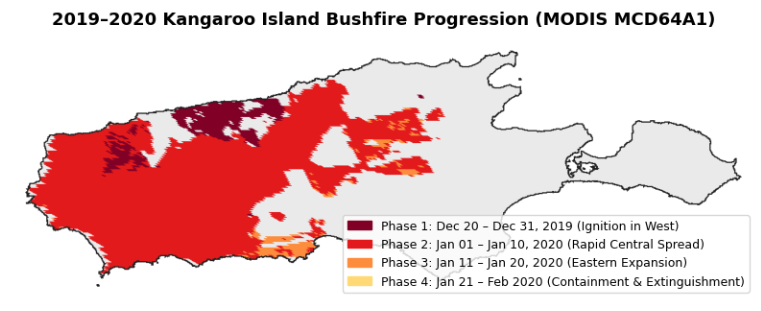

> **교육용 합성자료에 기반한 학술 보고서 예시.** 본문은 실제 도시·Landsat 관측 결과를 제시하지 않는다. 기본 탐색용 36개 표본과 세부목적 분석용 384행은 서로 다른 합성자료이다. 연구 질문을 학술적 목적으로 구체화하는 과정을 보여주기 위해 일상적 질문과 정식 목적 진술을 함께 제시하였다.

### 초록 {#abstract}

## 1. 연구 배경 {#background}

대형산불은 단기간에 광범위한 산림을 훼손하며, 화재가 진압된 이후에도 식생 상태와 산림 환경에 장기적인 영향을 미칠 수 있다. 산불 직후의 피해면적과 피해강도를 파악하는 것은 피해 규모를 이해하는 데 중요하지만, 이러한 정보만으로는 피해지역의 식생이 이후 얼마나 회복되었는지 판단하기 어렵다. 같은 산불의 영향을 받은 지역이라도 초기 피해강도와 환경 조건에 따라 식생 회복 속도와 양상이 다르게 나타날 수 있기 때문이다. 따라서 산불의 장기적인 영향을 이해하기 위해서는 발생 당시의 피해 정도와 이후 식생 변화를 함께 살펴볼 필요가 있다. 나아가 이러한 분석은 회복이 상대적으로 더딘 우선 복원 구역을 파악하고, 산불 피해지역의 장기 모니터링 및 산림 관리 예산을 효율적으로 배분하는 데 필요한 객관적 기초자료로 활용될 수 있다.

본 연구에서는 이러한 변화를 살펴볼 대상지로 호주 남호주주(South Australia)에 위치한 캥거루섬(Kangaroo Island)을 선정하였다. 캥거루섬 대형산불은 2019년 12월 20일경 섬 서부에서 발화하여 강한 바람과 고온 건조한 기상 조건 속에 동쪽으로 급속히 확산되었으며, 약 한 달간 이어진 뒤 2020년 1월 말 진화되었다. 남호주 환경수자원부(DEW) 공식 집계에 따르면 이 산불로 섬 전체 면적의 약 48%에 해당하는 약 211,474ha가 소실되었으며, 플린더스 체이스 국립공원(Flinders Chase National Park)을 비롯한 자연보호지역과 고유 야생동물 서식지가 광범위하게 훼손되었다. 캥거루섬은 광범위한 산불 피해지역과 화재가 발생하지 않은 산림지역이 함께 존재하여, 동일한 섬 내에서 피해강도별 식생 회복 양상을 비교할 수 있다는 특징이 있다. 이에 본 연구에서는 산불 발화 이전인 2019년 2 ~ 4월을 산불 전 기준기, 산불이 완전히 진압된 직후인 2020년 2월 7일 ~ 4월 30일을 피해 평가기, 2021 ~ 2025년 매년 2 ~ 4월을 장기 회복 관측기로 설정하여 산불 전후의 변화 과정을 시계열로 추적하였다.


그림 1. 산불 발화 ~ 진화 날짜별 확산 지도

캥거루섬의 산불과 식생 회복에 관한 선행연구로 Bonney 등(2020)은 1988년부터 2020년까지의 Landsat 위성자료를 활용하여 과거 산불 47건의 피해강도와 식생 회복 특성을 분석하였다. 연구 결과, 식생 회복 양상은 초기 피해 상태와 과거 산불 이력, 식생 유형 등에 따라 달라졌으며, 피해강도가 높다고 반드시 회복 속도가 느린 것은 아닌 것으로 나타났다. 그러나 해당 연구는 주로 과거 산불의 회복 특성을 분석하여 2019~2020년 대형산불 이후의 회복을 전망한 것으로, 실제 대형산불 진화 이후 여러 해에 걸쳐 나타난 식생 변화를 확인하기에는 관측 기간에 한계가 있었다. 따라서 2020년 산불 진화 이후 2025년까지 관측 범위를 확대하여 피해강도에 따른 식생 녹색도의 변화와 회복 양상을 비교하고, 과거 산불 사례에서 확인된 회복 특성이 이번 대형산불 이후에도 유사하게 나타나는지 검토할 필요가 있다.


그림 2. 위성영상으로 확인한 캥거루섬 산불 피해 범위
출처: NASA Earth Observatory

한편, 산불 이후 관측되는 식생 변화가 모두 산불의 영향만으로 발생하는 것은 아니다. 강수량은 토양 수분과 식생의 생육 조건에 영향을 주므로, 산불 피해 여부와 관계없이 연도별 식생지수의 변동을 일으킬 수 있다. 따라서 산불 피해지역의 NDVI가 증가했다는 사실만으로 식생 회복을 단정하기는 어렵다. 이러한 문제를 고려하기 위해서는 강수량과 식생 변화의 연관성을 살펴보는 동시에, 산불이 발생하지 않은 산림지역의 NDVI 변화를 비교 기준으로 활용할 필요가 있다. 이를 통해 산불 피해지역과 비피해 산림에서 나타나는 식생 변화의 공통점과 차이점을 파악하고, 피해강도에 따른 장기 식생 회복 양상을 보다 신중하게 해석하고자 한다.

이러한 분석을 수행하기 위해서는 광범위한 산불 피해지역의 산불 이전 상태와 이후 변화를 장기간 반복적으로 관찰할 수 있는 자료가 필요하다. 현장 조사는 실제 식생 상태를 상세하게 확인할 수 있고 드론은 높은 공간해상도의 영상을 확보할 수 있지만, 넓은 지역을 여러 해에 걸쳐 동일한 범위에서 반복 조사하거나 과거의 관측자료를 확보하는 데에는 제약이 있다. 반면 위성 원격탐사는 광범위한 지역을 주기적으로 관측하며, 축적된 과거 영상을 활용하여 산불 발생 이전과 이후의 식생 변화를 비교할 수 있다는 장점이 있다. 특히 산불 전후의 정규화 연소지수(NBR) 차이인 dNBR을 이용하면 피해강도를 구분할 수 있으며, 정규화 식생지수(NDVI)를 활용하면 연도별 식생 녹색도의 변화를 정량적으로 분석할 수 있다. 따라서 위성자료는 캥거루섬의 산불 피해강도와 장기적인 식생 변화의 공간적 차이를 함께 분석하는 데 적합하다.

이에 본 연구에서는 Sentinel-2와 MODIS 위성자료를 활용하여 2019년 12월~2020년 1월 호주 캥거루섬 대형산불의 피해강도에 따른 장기 식생 회복의 시공간적 특성을 분석하고자 한다. 먼저 Sentinel-2 영상의 dNBR을 이용하여 산불 피해강도를 구분하고 공간적 분포를 파악하며, MODIS MCD64A1 산불 탐지자료와 중첩하여 피해 범위의 공간적 일치도를 검증한다. 이후 Sentinel-2 자료를 활용하여 2019년부터 2025년까지의 연도별 NDVI 변화를 분석함으로써 피해강도별 식생 녹색도의 회복 양상과 차이를 비교한다. 또한 강수량과 NDVI 변화의 연관성을 살펴보고, 산불 비피해 산림의 식생 변화와 비교하여 관측된 회복 양상을 보다 신중하게 해석하고자 한다. 이를 통해 피해강도에 따른 장기 식생 회복의 차이를 정량적으로 파악하고, 향후 산불 피해지역의 지속적인 모니터링과 산림 관리에 활용할 수 있는 기초자료를 제공하고자 한다.

## 2. 연구 질문 {#question}

연구 배경에서 제시한 문제의식을 구체적으로 검토하기 위해 세 가지 연구 질문을 설정하였다. 일상적 질문을 통해 연구의 출발점을 제시하고, 학술적 연구 질문에서는 분석 대상, 비교 조건 및 정량적 분석 지표를 명시하였다. 연구 질문 1~3은 다음 절의 세부 연구목적 1~3에 각각 대응한다.

### 2.1 연구 질문 1

> **일상적 질문.** "2020년 호주 캥거루섬 대형산불은 얼마나 넓은 지역에 피해를 주었으며, 어느 지역에서 피해가 가장 심했을까?"

**학술적 연구 질문.** "Sentinel-2 위성영상의 산불 전후 정규화 연소지수(NBR) 차이인 dNBR을 활용했을 때, 2020년 호주 캥거루섬 대형산불의 피해 면적과 피해강도별 면적 비율 및 공간적 분포는 어떻게 나타나는가?"

### 2.2 연구 질문 2

> **일상적 질문.** "산불 피해가 심했던 지역과 피해가 적었던 지역의 회복 속도가 다를까? 2025년까지 얼마나 회복되었을까?"

**학술적 연구 질문.** "dNBR로 구분한 산불 피해강도에 따라 2020~2025년 연도별 NDVI 변화 추이는 어떠하며, 2019년 산불 이전과 2020년 산불 직후 NDVI를 기준으로 산정한 식생 회복률은 피해강도별로 어떠한 차이를 보이는가?"

### 2.3 연구 질문 3

 > **일상적 질문.** "산불 이후 식생이 다시 자라는 과정은 강수량과 어떤 관련이 있을까? 산불이 발생하지 않은 지역과 비교하면 식생 변화에 어떤 차이가 있을까?"

**학술적 연구 질문.** "2020~2025년 호주 캥거루섬에서 산불 피해 산림과 산불 비탐지 산림의 연도별 NDVI 변화 추이는 어떻게 다르며, 각 집단의 NDVI 변화는 같은 기간 강수량과 어떠한 상관관계를 보이는가?"

## 3. 연구 목적 {#objectives}

### 3.1 전체 연구목적

 2019년 말부터 2020년 초까지 대형산불이 발생한 호주 캥거루섬은 피해 규모가 광범위할 뿐만 아니라 지역별로 연소 강도가 다르게 나타나 산불 이후 식생이 장기적으로 어떻게 회복되는지 추적하기에 적합한 대상지이다. 기존 연구들이 주로 산불 직후의 소실 면적 산정에 집중하거나 과거 산불 이력을 바탕으로 회복 양상을 전망하는 데 그쳤다면 **본 연구는 2019년부터 2025년까지 축적된 Sentinel-2 위성영상과 보조 위성자료를 활용하여 실제 대형산불 이후 5년간 식생이 어떻게 회복되었는지 구체적으로 살펴보고자 한다.**

 본 연구에서 정의하는 식생 회복 특성은 피해 심각도 등급에 따른 연도별 NDVI 변화 속도, 산불 직후 감소량 대비 회복률, 그리고 산불 이전(2019년) 상태와의 잔여 격차를 의미한다. 다만 위성영상에서 산출되는 분광지수는 지표면의 광학적 반사 특성을 반영할 뿐이므로 분광학적 녹색도의 상승이 실제 성숙한 산림 생태계의 완전한 복원을 의미하지는 않는다. 이에따라 강수량 변화 및 산불 비피해 산림과의 비교 검증을 병행하여 기상 요인에 의한 착시를 분리하고 향후 산불 피해지역의 장기 모니터링과 산림 복원·관리 방향을 설정하는 데 필요한 기초자료를 제공하고자 한다.

### 3.2 세부목적 1 · dNBR 기반 산불 피해 범위 산출 및 피해강도별 피해 면적 산정

**연구 질문 1의 목적화.** 2019년과 2020년 동일 계절(2~4월)의 구름·그림자 제거 중앙값 합성영상을 구축한 후 Sentinel-2의 근적외선(B8)과 단파적외선(B12) 밴드를 이용하여 dNBR을 산출하고 캥거루섬의 피해 범위 및 6개 피해강도별 면적을 산정한다.

**필요성 및 평가 지표.** 산불 피해는 지형과 기존 식생 밀도에 따라 연소 강도가 크게 달라지므로 단일한 피해 경계만으로는 이후 구역별로 상이하게 나타나는 식생 회복 속도의 차이를 설명하기 어렵다. dNBR 등급별 피해 면적과 전체 연구지역 대비 비율 그리고 공간해상도와 탐지 방식이 상이한 NASA MODIS 산불 탐지자료를 절대적 참값이 아닌 교차 검증 기준으로서 중첩한 공간 일치도(IoU)를 평가 지표로 산출하여 후속 회복 분석의 공간적 기준 등급을 설정한다.


그림 3. 2020년 1월 대형산불 발생 직후의 호주 캥거루섬 위성영상
출처: NASA Earth Observatory (2020.01.07)


### 3.3 세부목적 2 · 피해강도에 따른 장기 식생 회복 추이 비교

**연구 질문 2의 목적화.** 2019년부터 2025년까지 매년 동일 계절(2~4월)에 관측된 Sentinel-2 영상에서 적색광(B4)과 근적외선(B8) 밴드를 활용하여 연도별 대표 NDVI 시계열 자료를 구축하고, 세부목적 1에서 분류한 dNBR 피해강도 4개 등급(3등급: 낮은 피해 ~ 6등급: 높은 피해)과 중첩한다. 이를 통해 각 등급의 ① 연도별 평균 NDVI 증감 경로 및 성장 둔화 시점, ② 산불 직후(2020년) NDVI 감소량 대비 2025년 상대적 회복률($R_{2025}$ %), ③ 산불 이전(2019년) 평균 NDVI 대비 2025년 잔여 격차($\Delta\mathrm{NDVI}_{2025}$)를 산출하여 피해강도 등급 간 회복 속도와 도달 수준의 차이를 정량적으로 비교한다.

**필요성 및 평가 지표.** 피해지역 전체의 평균 변화만을 분석할 경우 피해 심각도에 따른 회복 속도의 차이나 극심한 피해지에서 초본류 및 개척 식생이 일시적으로 번성하여 나타나는 초기 변화 특성을 구분하기 어렵다. 이에 dNBR 3~6등급별 연도별 평균 NDVI 궤적, 2020년 감소량 대비 상대적 회복률, 그리고 산불 진화 5년 후인 2025년과 산불 이전 2019년 간의 NDVI 잔여 격차를 평가 지표로 함께 제시하여 피해강도에 따른 회복 속도의 차이와 2023년 이후 성장이 둔화되는 정체 구간의 폭을 수치로 도출한다.

### 3.4 세부목적 3 · 강수량과 식생 회복의 연관성 검토 및 비피해지역과의 비교

**연구 질문 3의 목적화.** 산불 이후 나타난 식생 변화를 보다 구체적으로 해석하기 위해 강수량과 NDVI 사이의 연관성을 검토하고, 산불 피해 산림과 비탐지 산림의 식생 변화를 비교한다. 이를 통해 피해지역에서 관측된 식생 변화가 강수량 및 일반적인 연도별 식생 변화와 어떠한 관계를 보이는지 살펴본다.

**필요성 및 평가 지표.** 산불 이후 NDVI의 증가는 식생의 재생뿐만 아니라 강수량 등 환경 조건의 영향을 함께 반영할 수 있다. 따라서 CHIRPS 강수량 자료와 NDVI의 Pearson 상관계수를 산출하여 두 변수의 선형적 연관성을 검토한다. 또한 산불 피해 산림과 비탐지 산림의 2019년 대비 연도별 NDVI 변화량을 비교하여 두 지역의 식생 변화 양상에 어떠한 차이가 나타나는지 확인한다.

주요 결과물은 연도별 강수량·NDVI 비교표, 상관계수 및 피해·비탐지 산림의 NDVI 변화 비교 그래프이다. 단, 상관분석과 지역 간 비교만으로 강수량의 인과적 영향을 규명하거나 산불의 영향과 기후 영향을 완전히 분리할 수는 없다는 점을 고려한다.


그림 4. 남호주 평년대비 강수량 편차 지도
출처: Australian Bureau of Meteorology, BOM: South Australian rainfall percentages (1 January to 31 December 2020)

## 4. 재료 {#materials}

# 4. 연구 재료 (Materials)

## 4.1. 연구 대상 지역 및 분석 기간

본 연구의 대상 지역은 호주 남호주주(South Australia)에 위치한 캥거루섬이다. 캥거루섬은 2019년 말부터 2020년 초까지 대규모 산불이 발생한 지역으로, 산불 이전의 식생 상태와 이후 회복 과정을 비교하기에 적합하다고 판단하였다.

연구지역의 공간적 범위는 Google Earth Engine(GEE)에서 제공하는 FAO GAUL 2025의 2단계 행정경계 자료를 활용하여 설정하였다. 해당 자료에서 캥거루섬에 해당하는 경계를 추출하였으며, GEE로 계산한 연구지역 면적은 약 4,400.366km²이다. 이후 수행한 산불 피해 분석과 식생 회복 분석에는 동일한 연구지역 경계를 적용하였다.

전체 분석 기간은 2019년부터 2025년까지다. 산불 이전 상태는 2019년 2월 1일부터 4월 30일까지, 산불 직후 상태는 2020년 2월 7일부터 4월 30일까지를 기준으로 설정하였다. 실제 검색된 Sentinel-2 영상의 촬영일은 산불 이전 2019년 2월 1일~ 4월 30일, 산불 이후 2020년 2월 9일~ 4월 29일이었다.

2021년부터 2025년까지의 식생 변화는 매년 2월 1일부터 4월 30일까지의 영상으로 분석하였다. 매년 비슷한 계절을 선택하여 계절에 따른 식생 변화의 영향을 줄이고자 하였으며, 산불 전후의 관측 시기 차이가 분석에 미칠 수 있는 영향도 함께 고려하였다.

## 4.2. 위성 관측자료

본 연구의 주요 위성자료는 유럽연합 Copernicus 프로그램의 Sentinel-2 Level-2A 지표반사도(Surface Reflectance) 영상이다. GEE에서 사용한 데이터셋 ID는 `COPERNICUS/S2_SR_HARMONIZED`이다. 이 자료는 대기보정된 지표반사도 자료이며, 서로 다른 처리 시기의 영상값을 비교할 수 있도록 조정한 Harmonized 컬렉션을 사용하였다.

Sentinel-2에서 사용한 주요 밴드는 B2(청색), B3(녹색), B4(적색), B8(근적외선), B12(단파적외선)이다. B2, B3, B4, B8의 원래 공간해상도는 10m이고, B12는 20m이다. 구름과 구름 그림자 등을 구분하기 위한 SCL(Scene Classification Layer)은 20m 해상도를 가진다.

B2·B3·B4는 산불 전후 자연색 영상 제작에 활용하였으며, B8과 B12는 NBR 및 dNBR 계산에 사용하였다. 식생 상태를 나타내는 NDVI는 B8과 B4를 이용하여 계산하였다. NBR, dNBR, NDVI는 모두 반사도에서 계산되는 무차원 지수이다.

Sentinel-2의 지표반사도 밴드는 원래 반사도에 10,000을 곱한 값으로 제공된다. 본 연구에서는 자연색 영상 제작 시 0.0001의 배율을 적용하였으며, 정규화 지수는 두 밴드의 비율을 이용하여 계산하였다.

위성영상 확보량을 확인한 결과, 최초 설정한 3개월 분석 기간에서 2019년 90장, 2020년 90장의 영상 장면이 검색되었다. 이후 산불 전후 대표 영상 제작에 사용한 기간에서는 2019년 90장, 2020년 83장이 확인되었다. 이 수치는 캥거루섬과 공간적으로 겹치는 개별 위성영상 장면의 수이며, 독립적인 현장 관측지점 수를 의미하지 않는다.

## 4.3. 산불 범위 및 토지피복 보조자료

Sentinel-2의 산불 피해 분석 결과를 비교하고 산불 발생지역을 구분하기 위해 NASA의 MODIS MCD64A1 Version 6.1 자료를 사용하였다. GEE 데이터셋 ID는 `MODIS/061/MCD64A1`이며, 원래 공간해상도는 500m이다.

MCD64A1은 월별 산불 소실지역을 추정한 자료로, 본 연구에서는 `BurnDate` 밴드를 사용하였다. BurnDate는 연소가 탐지된 날짜를 연중 일수로 나타내며, 0은 연소가 탐지되지 않은 픽셀을 의미한다. 2019년 12월 1일부터 2020년 2월 29일까지의 자료에서 BurnDate가 0보다 큰 픽셀을 추출하고, 해당 기간의 연소 탐지지역을 하나의 공간 범위로 결합하였다.

이 자료는 Sentinel-2에서 계산한 dNBR 피해지역과 비교하는 데 사용하였으며, 식생 회복 분석의 공간적 범위를 설정하는 데에도 활용하였다. 다만 MODIS 산불 탐지지역은 위성자료로 추정한 결과이므로 실제 산불 경계와 완전히 일치한다고 볼 수는 없다.

산불 이전 토지피복을 구분하기 위해 Google과 World Resources Institute(WRI)의 Dynamic World V1 자료를 사용하였다. GEE 데이터셋 ID는 `GOOGLE/DYNAMICWORLD/V1`이며, 공간해상도는 10m이다.

Dynamic World는 수역, 산림, 초지, 농경지, 관목 등 총 9개 토지피복 유형을 구분하는 자료이다. 본 연구에서는 2019년 2~4월의 `label` 밴드를 사용하였으며, 여러 날짜에서 가장 자주 나타난 분류값을 대표 토지피복으로 설정하였다.

이후 산림을 나타내는 분류 코드 1(Trees)을 추출하여 산림지역의 피해 심각도별 NDVI 회복률을 별도로 분석하였다. 해당 자료는 위성영상으로 추정한 토지피복 분류 결과이며, 현장에서 직접 조사한 식생 분포 자료는 아니다.

## 4.4. 강수량 자료 및 분석 변수

산불 이후 식생 변화에 영향을 줄 수 있는 강수 조건을 검토하기 위해 CHIRPS(Climate Hazards Center InfraRed Precipitation with Station data) Daily 자료를 사용하였다.

CHIRPS는 미국 캘리포니아대학교 산타바버라 캠퍼스(UCSB)의 Climate Hazards Center에서 제공하는 자료로, 위성 기반 강수 추정과 지상 관측소 자료를 결합한 격자형 강수량 자료이다. GEE 데이터셋 ID는 `UCSB-CHG/CHIRPS/DAILY`이며, 사용한 컬렉션은 Version 2.0 Final이다.

CHIRPS의 원래 공간해상도는 약 0.05°(약 5.6km)이고, 시간해상도는 1일이다. 본 연구에서는 `precipitation` 밴드를 사용하였으며, 일별 강수량의 단위는 mm/day이다.

2019~ 2025년을 대상으로 매년 2~4월 누적 강수량과 전년도 11월부터 해당 연도 4월까지의 누적 강수량을 계산하였다. 일별 강수량을 기간별로 합산한 후 산불 탐지지역의 공간 평균값을 구하였으며, 최종 누적 강수량은 mm 단위로 나타내었다.

주요 분석 변수는 산불 피해 심각도를 나타내는 dNBR, 식생 녹색도를 나타내는 NDVI, 산불 탐지 여부, 토지피복 유형 및 누적 강수량이다. 피해 면적은 km², NDVI 감소량 대비 회복률과 면적 비율은 % 단위로 정리하였다.

## 4.5. 자료의 구성 및 분석 표본

본 연구에서 사용한 자료는 개별 위성 관측자료와 이를 가공한 분석자료로 구분된다.

Sentinel-2의 개별 지표반사도 영상은 위성 관측에 기초한 자료이며, MODIS 산불 소실지역, Dynamic World 토지피복, CHIRPS 강수량은 각각 별도의 처리 과정을 거쳐 제공되는 자료이다.

연도별 대표 NDVI 영상은 여러 날짜의 Sentinel-2 영상에서 구름과 그림자 등을 제거하고 NDVI를 계산한 후, 픽셀별 중앙값을 구하여 생성하였다. 산불 전후 NBR과 dNBR, 피해 심각도 등급 지도, NDVI 회복률 및 강수량 누적값은 이들 자료를 추가로 가공하여 계산한 파생자료이다. 따라서 연도별 대표 영상은 특정 날짜에 촬영한 단일 위성영상과 구분된다.

면적과 평균 NDVI 등 주요 공간 통계는 주로 EPSG:32753 좌표계와 100m 분석 격자를 사용하여 계산하였다. 일부 산불 탐지 범위 비교에는 MODIS의 원래 해상도인 500m 격자를 사용하였으며, NBR 및 dNBR 피해 등급 면적의 초기 계산에는 20m 격자를 사용하였다. 분석에 사용한 격자 크기는 원래 위성자료의 공간해상도와 구분하였다.

분석 표본은 2019~ 2025년의 연도별 대표 NDVI 영상 7개와 각 영상에 포함된 공간 픽셀로 구성된다. 피해 심각도별 분석에서는 dNBR을 기준으로 6개 등급을 구분하였고, 회복률 비교에는 이 중 3~ 6등급을 사용하였다.

비피해지역 대조 분석에서는 2019년 산림으로 분류된 지역 중 MODIS 산불 탐지 산림 1,427.364km²와 산불 비탐지 산림 795.482km²를 비교하였다. 비탐지 산림은 산불 탐지지역으로부터 1km 이내의 구역을 제외하여 설정하였다.

본 연구의 분석 단위는 개별 현장 조사 지점이 아닌 위성영상의 공간 픽셀과 연도별 합성영상이다. 동일한 캥거루섬 지역을 대상으로 2019년부터 2025년까지의 위성영상을 비교하였다. 따라서 각 연도의 영상은 서로 다른 지역을 조사한 자료가 아니라, 같은 지역의 식생 변화를 시간에 따라 관찰한 자료이다.

또한 산불 탐지 여부, 토지피복 유형 및 식생지수는 위성자료에 기반한 추정값이므로 현장 조사 결과와 차이가 존재할 수 있다. 이러한 자료의 특성을 고려하여 분석 결과의 해석과 검증을 수행하였다.

## 5. 방법 {#method}

## 5.1 자료 처리 및 기초 분석

본 연구에서는 Google Earth Engine(GEE)과 Google Colab을 활용하여 호주 캥거루섬의 산불 피해 범위와 이후 식생 회복 과정을 분석하였다. 먼저 FAO GAUL 행정경계 자료에서 캥거루섬에 해당하는 경계를 추출하여 연구 대상 지역을 설정하였다.

산불 전후 비교에는 Sentinel-2 Level-2A 지표반사도 자료를 사용하였다. 산불 이전 영상은 2019년 2월 1일부터 4월 30일까지, 산불 이후 영상은 2020년 2월 7일부터 4월 30일까지를 대상으로 하였으며, 2021년부터 2025년까지도 매년 2~4월의 영상을 수집하였다.

수집한 위성영상은 구름과 그림자 등의 결측·오차 요인을 제거하기 위해 품질 관리를 수행하였다. Sentinel-2의 SCL(Scene Classification Layer) 밴드를 이용하여 분류값 2(어두운 지표), 4(식생), 5(나지), 6(수역)에 해당하는 픽셀만 남기고, 구름(7~10번)과 구름 그림자(3번) 등은 마스킹하여 제외하였다. 특히 산불 진화 직후 숯과 재로 덮인 고강도 피해 픽셀은 반사도가 극히 낮아 Sen2Cor 대기보정 알고리즘에서 SCL 2번(Dark area pixels)으로 분류되므로, 실제 고강도 피해지의 데이터 누락을 방지하기 위해 2번 픽셀을 유효 관측치로 포함하였다.


이후 구름 및 그림자 마스킹을 적용한 영상들을 기간별로 묶고 픽셀 중앙값(median) 합성을 수행하여 개별 관측영상의 대기 잡음과 잔여 연무 영향을 줄인 대표 영상을 생성하였다. 산불 전후 NBR 분석에는 각 기간의 반사도 중앙값 영상을 사용하였으며, 연도별 NDVI 분석에는 개별 영상에서 NDVI를 계산한 뒤 중앙값 영상을 생성하였다.공간자료의 통계 분석에는 EPSG:32753 좌표계를 사용하였으며, 피해 등급별 초기 면적 계산에는 20m 격자를, 산불 탐지 범위 비교와 연도별 평균 NDVI 계산에는 주로 100m 격자를 적용하여 $\text{km}^2$ 단위로 환산하였다.

## 5.2 세부목적 1의 분석

첫 번째 세부목적은 2019~2020년 캥거루섬 산불의 피해 범위를 산출하고 피해강도를 정량화하는 것이다. 이를 위해 산불 이전과 이후의 Sentinel-2 영상에서 NBR(Normalized Burn Ratio)을 계산하였다.

NBR은 근적외선과 단파적외선 반사도의 차이를 이용하여 식생 및 산불로 인한 지표 변화를 파악하는 지수이다.

**[식 (1) NBR 계산식]**


여기서 \(B_8\)은 근적외선 밴드, \(B_{12}\)는 단파적외선 밴드의 지표반사도를 의미한다.

산불 이전과 이후의 NBR을 각각 계산한 다음, 두 시기의 차이를 이용하여 dNBR(differenced Normalized Burn Ratio)을 산출하였다.

**[식 (2) dNBR 계산식]**


여기서 \(\mathrm{NBR}_{pre}\)는 산불 이전 NBR, \(\mathrm{NBR}_{post}\)는 산불 이후 NBR을 의미한다.

계산된 dNBR 값은 6개 등급으로 구분하였다.

| 등급 | dNBR 범위 | 피해 구분 |
|---|---|---|
| 1 | -0.10 미만 | 음의 변화 |
| 2 | -0.10 이상 ~ 0.10 미만 | 비연소 또는 변화 작음 |
| 3 | 0.10 이상 ~ 0.27 미만 | 낮은 피해 |
| 4 | 0.27 이상 ~ 0.44 미만 | 중간-낮은 피해 |
| 5 | 0.44 이상 ~ 0.66 미만 | 중간-높은 피해 |
| 6 | 0.66 이상 | 높은 피해 |

분류된 결과를 이용하여 연구지역 전체의 피해 심각도 분포도를 제작하고 각 등급의 면적을 계산하였다. 이를 통해 산불 피해가 집중된 지역과 등급별 공간 분포를 확인하고자 하였다.

또한 MODIS MCD64A1 자료를 이용하여 Sentinel-2 기반 피해지역 추정 결과를 비교하였다. 2019년 12월부터 2020년 2월까지 MODIS의 BurnDate 값이 0보다 큰 지역을 산불 탐지지역으로 설정하고, dNBR 3~6등급에 해당하는 지역과 중첩하였다.

두 자료 사이의 공간적 일치 정도는 IoU(Intersection over Union)를 이용하여 계산하였다.

**[식 (3) 공간적 일치도 계산식]**


여기서 \(A\)는 dNBR 3~6등급 지역, \(B\)는 MODIS 산불 탐지지역이다. \(|A\cap B|\)는 두 자료에서 공통으로 나타나는 면적, \(|A\cup B|\)는 두 자료 중 하나 이상에 포함되는 전체 면적을 의미한다.

IoU는 두 위성 기반 자료의 공간적 일치 정도를 확인하기 위한 지표로 사용하였으며, MODIS 자료를 실제 산불 피해 범위의 절대적인 기준으로 간주하지는 않았다.

## 5.3 세부목적 2의 분석

두 번째 세부목적은 산불 피해강도에 따른 식생 회복 추이를 분석하는 것이다. 이를 위해 2019년부터 2025년까지 Sentinel-2 영상을 이용하여 연도별 NDVI(Normalized Difference Vegetation Index)를 계산하였다.

NDVI는 근적외선과 적색 밴드의 반사도 차이를 이용하여 식생의 녹색도를 나타내는 지수이다.

**[식 (4) NDVI 계산식]**


여기서 \(B_8\)은 근적외선 밴드, \(B_4\)는 적색 밴드의 지표반사도를 의미한다.

매년 2~4월에 관측된 Sentinel-2 영상에서 NDVI를 계산한 후 픽셀별 중앙값을 이용하여 연도별 대표 NDVI 영상을 생성하였다. 산불이 발생한 2020년은 2월 7일 이후의 영상을 사용하여 산불 이후 식생 상태를 분석하였다.

먼저 MODIS 산불 탐지지역을 기준으로 2019~2025년의 평균 NDVI를 산출하였다. 2019년을 산불 이전 기준으로 설정하고, 산불 직후인 2020년부터 2025년까지 NDVI가 어떻게 변화했는지 비교하였다.

이후 첫 번째 세부목적에서 계산한 dNBR 피해 등급을 연도별 NDVI 영상과 중첩하여 등급별 평균 NDVI를 계산하였다. 특히 산불 피해지역의 회복 양상을 비교하기 위해 dNBR 3~6등급을 주요 분석 대상으로 설정하였다.

피해강도별 회복 수준을 비교하기 위해 2020년에 감소한 NDVI가 이후 얼마나 증가했는지를 회복률로 계산하였다.

**[식 (5) NDVI 감소량 대비 회복률]**


여기서 \(R_t\)는 분석 연도 \(t\)의 NDVI 감소량 대비 회복률이며, \(\mathrm{NDVI}_{2019}\)는 산불 이전 평균 NDVI, \(\mathrm{NDVI}_{2020}\)은 산불 직후 평균 NDVI를 의미한다.

회복률이 0%이면 2020년의 NDVI 수준과 같고, 100%이면 2019년의 NDVI 수준에 다시 도달했다는 의미이다. 다만 이 회복률은 NDVI 변화에 근거한 상대적인 수치로, 실제 산림 생태계가 완전히 복원되었다는 의미는 아니다.

또한 회복률이 높은 지역이라도 산불 이전의 식생 상태에 도달하지 못했을 가능성이 있으므로, 2025년과 2019년의 NDVI 차이를 추가로 계산하였다.

**[식 (6) 산불 이전 대비 NDVI 차이]**


이를 통해 피해강도별 상대적 회복률과 산불 이전 대비 남아 있는 NDVI 차이를 함께 비교하였다.

## 5.4 세부목적 3의 분석 및 검증

세 번째 세부목적에서는 강수량과 식생 회복의 연관성을 검토하고, 산불 피해지역과 비피해지역의 식생 변화 차이를 비교하였다. 이를 위해 산림지역 분석, 강수량 비교 및 산불 탐지지역과 비탐지지역의 대조 분석을 수행하였다.

먼저 Dynamic World 토지피복 자료를 활용하여 산불 이전인 2019년의 산림지역을 추출하였다. 2019년 2~4월 자료에서 토지피복 분류값의 최빈값을 계산하여 대표 토지피복 지도를 제작하였으며, 산림에 해당하는 Trees(분류 코드 1)를 선택하였다.

이후 산림지역을 MODIS 산불 탐지지역 및 dNBR 피해 심각도 지도와 중첩하여 산림에 해당하는 피해지역을 구분하였다. 이렇게 추출한 산림지역에서 피해강도별 NDVI와 회복률을 계산하고, 전체 산불 탐지지역의 분석 결과와 비교하였다.

다음으로 강수량과 식생 변화의 관계를 살펴보기 위해 CHIRPS 일별 강수량 자료를 사용하였다. 매년 2~4월 누적 강수량과 전년도 11월부터 해당 연도 4월까지의 누적 강수량을 산출하였으며, 산불 탐지지역의 평균 NDVI와 비교하였다.

강수량과 NDVI 사이의 선형적인 관계를 확인하기 위해 Pearson 상관계수를 계산하였다.

**[식 (7) Pearson 상관계수]**


여기서 \(x_i\)는 연도별 누적 강수량, \(y_i\)는 해당 연도의 평균 NDVI이며, \(\bar{x}\)와 \(\bar{y}\)는 각각 두 변수의 평균이다. \(n\)은 상관계수 계산에 사용한 연도별 관측값의 수이다.

상관계수는 두 변수 사이의 선형적 관계를 확인하는 데 활용하였으며, 강수량이 식생 회복을 직접적으로 유발했는지 판단하는 근거로 사용하지 않았다.

마지막으로 산불 탐지 산림과 비탐지 산림의 NDVI 변화를 비교하는 대조 분석을 수행하였다.

2019년 Dynamic World에서 산림으로 분류된 지역 중 MODIS 산불 탐지지역에 포함되는 지역을 산불 탐지 산림으로 설정하였다. 산불 비탐지 산림은 산불 탐지지역으로부터 1km 이내의 구역을 제외하여 설정하였다.

이후 두 집단에서 2019~2025년의 연도별 평균 NDVI를 각각 계산하였다. 두 집단은 산불 이전의 NDVI 수준이 서로 다를 수 있으므로, 각 집단의 2019년 NDVI를 기준으로 연도별 변화량을 계산하였다.

**[식 (8) 2019년 대비 NDVI 변화량]**


여기서 \(g\)는 산불 탐지 산림 또는 비탐지 산림 집단을, \(t\)는 분석 연도를 의미한다.

이어서 두 집단의 NDVI 변화량 차이를 계산하였다.

**[식 (9) 집단 간 NDVI 변화량 차이]**


여기서 \(B\)는 산불 탐지 산림, \(U\)는 산불 비탐지 산림을 의미한다.

이러한 방법으로 산불 탐지 산림의 NDVI 변화가 비탐지 산림과 얼마나 다르게 나타나는지 비교하였다. 다만 두 집단의 위치, 식생 구성, 지형 조건 및 산불 이전 상태가 동일하지 않으므로, 분석 결과를 산불의 순수한 인과효과로 해석하지는 않았다.

### 5.5 불확실성 및 재현성

본 연구는 위성영상을 활용하였기 때문에 관측 시기, 구름, 공간해상도 등에 따라 분석 결과에 차이가 발생할 수 있다. 이를 줄이기 위해 Sentinel-2의 SCL 밴드로 구름과 그림자 등을 제거하고, 매년 비슷한 시기의 영상을 중앙값으로 합성하였다. 또한 dNBR을 이용한 산불 피해지역 분석은 MODIS 산불 탐지자료와 비교하여 공간적 일치 정도를 확인하였다.

NDVI를 이용한 식생 회복률은 식생 녹색도의 변화를 나타내는 것으로, 실제 산림 생태계가 완전히 복원되었다는 의미는 아니다. 강수량과 NDVI의 상관분석 역시 관측 연도가 제한적이므로 강수량이 식생 회복에 직접적인 영향을 미쳤다고 단정하기 어렵다. 또한 산불 탐지지역과 비탐지지역의 지형 및 식생 조건이 서로 다를 수 있다는 한계가 있다.

연구의 재현성을 위해 Google Earth Engine에서 사용한 데이터셋 ID, 분석 기간, 계산식, 좌표계 및 공간해상도를 기록하였다. 모든 분석은 Google Colab에서 코드로 수행하여 동일한 조건에서 주요 계산 과정을 다시 확인할 수 있도록 하였다.

## 6. 결과 {#results}

## 6.1 표본 구성 및 기초 분포

본 연구에서는 호주 캥거루섬 전체를 연구지역으로 설정하고, 2019년부터 2025년까지의 위성자료를 활용하여 산불 피해와 식생 변화를 분석하였다. FAO GAUL 행정경계 자료를 통해 계산한 캥거루섬의 면적은 약 4,400.37km²로 나타났다. 연구지역의 지리적 위치와 공간적 범위는 그림 1에 나타내었다.


*그림 5. Google Colab과 GEE를 활용한 캥거루섬 연구지역 설정 및 시각화*

*자료: FAO GAUL 2025 행정경계, Google Earth Engine 및 geemap 활용*

산불 전후의 지표 상태를 비교하기 위해 Sentinel-2 영상을 수집하였다. 산불 전후 대표 영상 제작에 사용한 기간에서 2019년에는 90장, 2020년에는 83장의 영상 장면이 검색되었다. 각 기간의 영상에서 구름 등의 영향을 받는 픽셀을 제외하고 중앙값 합성영상을 생성하였다.

장기적인 식생 변화를 분석하기 위해 2019년부터 2025년까지 총 7개 연도의 대표 NDVI 영상을 제작하였다. 이 자료는 동일한 연구지역을 매년 관측한 결과로, 산불 이후 식생 변화를 시간에 따라 비교하는 데 사용하였다. 연구지역과 분석 표본의 구성은 표 1에 정리하였다.

**표 1. 연구지역 및 분석 표본의 구성**

| 구분 | 분석 결과 |
|---|---|
| 연구지역 | 호주 캥거루섬 |
| 연구지역 전체 면적 | 4,400.37km² |
| 분석 기간 | 2019~2025년 |
| 연도별 대표 NDVI 영상 | 7개 |
| MODIS 산불 탐지 면적 | 1,971.90km² |
| 전체 면적 대비 산불 탐지 비율 | 44.81% |
| 산불 탐지 산림 면적 | 1,427.36km² |
| 산불 비탐지 산림 면적(1km 완충구역 제외) | 795.48km² |

산불 탐지지역의 분포를 확인하기 위해 MODIS MCD64A1 자료를 분석하였다. 2019년 12월부터 2020년 2월까지 산불이 탐지된 면적은 약 1,971.90km²로 나타났으며, 이는 연구지역 전체 면적의 약 44.81%에 해당한다. MODIS 자료에서 산불이 탐지된 지역의 공간적 분포는 그림 2와 같다. 그림에서 확인할 수 있듯이 산불 탐지지역은 캥거루섬 서부를 중심으로 넓게 분포하였으며, 동부에서는 상대적으로 탐지 면적이 적게 나타났다.


*그림 6. MODIS 자료를 이용한 캥거루섬 산불 탐지지역의 공간적 분포*

*자료: NASA MODIS MCD64A1 V6.1, 2019년 12월~2020년 2월, Google Earth Engine 분석*

산불 탐지지역의 토지피복을 분석하기 위해 Dynamic World 자료를 활용하였다. 분석 결과, 산불 탐지지역에서 가장 넓은 면적을 차지하는 토지피복 유형은 산림(Trees)으로 나타났다. 산림 면적은 약 1,427.36km²로 전체 산불 탐지지역의 72.39%를 차지하였다. 그다음으로 초지(Grass) 265.09km²(13.44%), 농경지(Crops) 123.95km²(6.29%), 관목지(Shrub and Scrub) 90.06km²(4.57%) 순으로 나타났다.

**표 2. MODIS 산불 탐지지역의 주요 토지피복 분포**

| 토지피복 유형 | 면적(km²) | 비율(%) |
|---|---:|---:|
| 산림(Trees) | 1,427.36 | 72.39 |
| 초지(Grass) | 265.09 | 13.44 |
| 농경지(Crops) | 123.95 | 6.29 |
| 관목지(Shrub and Scrub) | 90.06 | 4.57 |
| 기타 | 65.44 | 3.32 |

*주: 토지피복 면적은 100m 분석 격자를 기준으로 계산하였으며, 반올림으로 인해 합계에 미세한 차이가 발생할 수 있다.*

산불 탐지지역에서 산림이 가장 큰 비중을 차지하는 것으로 나타나, 이후 식생 회복 분석에서는 산불 탐지지역 전체뿐만 아니라 산림지역만을 대상으로 한 분석도 함께 수행하였다.

또한 산불 탐지지역과 비탐지지역의 식생 변화를 비교하기 위해 2019년 산림 분류 결과를 기준으로 두 집단을 구성하였다. 산불 탐지 산림은 약 1,427.36km²였으며, 산불 탐지지역으로부터 1km 이내의 구역을 제외한 비탐지 산림은 약 795.48km²로 계산되었다. 이 두 집단을 대상으로 연도별 NDVI 변화를 비교하여 산불 탐지 여부에 따른 식생 변화 양상의 차이를 검토하였다.

### 6.2 세부목적 1의 결과: 산불 피해 범위 산출 및 피해강도 정량화

#### 6.2.1 dNBR 기반 산불 피해강도 분포

Sentinel-2 위성영상으로 산불 발생 전후의 NBR을 산출하고, 두 시기의 차이인 dNBR을 이용하여 캥거루섬의 산불 피해강도를 6개 등급으로 분류하였다. 분석 결과, 섬 전체에서 피해강도에 따른 분광 변화가 서로 다르게 나타났으며, 특히 높은 피해 등급에 해당하는 지역이 넓게 분포하는 것으로 확인되었다.


*그림 7. Sentinel-2 dNBR을 이용한 캥거루섬 산불 피해강도별 공간분포* *자료: ESA Sentinel-2 MSI, Google Earth Engine 분석*

**[표 3] dNBR 등급별 면적 및 전체 연구지역 대비 비율**

| 등급 | dNBR 범위 | 면적 (km²) | 비율 (%) |
|---|---|---:|---:|
| 1. 음의 변화 | dNBR < −0.10 | 498.330 | 11.32 |
| 2. 비연소/변화 작음 | −0.10 ≤ dNBR < 0.10 | 2,113.176 | 48.02 |
| 3. 낮은 피해 | 0.10 ≤ dNBR < 0.27 | 295.083 | 6.71 |
| 4. 중간-낮은 피해 | 0.27 ≤ dNBR < 0.44 | 130.379 | 2.96 |
| 5. 중간-높은 피해 | 0.44 ≤ dNBR < 0.66 | 263.980 | 6.00 |
| 6. 높은 피해 | dNBR ≥ 0.66 | 1,099.532 | 24.99 |

*주: 등급별 면적은 20m 공간해상도로 산출하였으며, 비율은 전체 연구지역 면적 4,400.366km²를 기준으로 계산하였다. 래스터 경계 처리로 등급별 면적 합계와 연구지역 전체 면적 사이에 미세한 차이가 발생할 수 있다.*

dNBR이 0.10 이상인 3~ 6등급의 면적은 총 1,788.974km²로, 캥거루섬 전체의 약 40.66%를 차지하였다. 이 중 가장 높은 피해강도에 해당하는 6등급의 면적은 1,099.532km²로, 섬 전체 면적의 약 24.99%에 해당하였다. 반면 dNBR이 0.10 미만인 1~ 2등급은 상대적으로 변화가 작거나 음의 변화가 나타난 지역으로 분류되었다.

이러한 결과는 산불 이후 캥거루섬에서 광범위한 분광 변화가 발생하였으며, 변화의 정도 역시 지역별로 차이가 있었음을 보여준다.

#### 6.2.2 MODIS 산불 탐지자료와의 비교

Sentinel-2의 dNBR 분석 결과와 MODIS의 산불 탐지 범위를 비교하여 두 자료 사이의 공간적 일치 정도를 확인하였다. MODIS MCD64A1 자료를 이용하여 2019년 12월부터 2020년 2월까지 산불이 탐지된 지역을 추출한 결과, 산불 탐지 면적은 1,971.900km²로 캥거루섬 전체 면적의 약 44.81%에 해당하였다.

두 자료의 공간적 비교를 위해 분석 해상도를 100m로 통일하였으며, dNBR이 0.10 이상인 지역을 산불 피해 후보지역으로 설정하였다.


*그림 8. Sentinel-2 dNBR 기반 피해지역과 MODIS 산불 탐지지역의 공간적 중첩 분포* *자료: ESA Sentinel-2 MSI, NASA MODIS MCD64A1 V6.1, Google Earth Engine 분석*

**[표 4] dNBR 피해지역과 MODIS 산불 탐지지역의 비교 결과**

| 분석 항목 | 결과 |
|---|---:|
| MODIS 산불 탐지 면적 | 1,971.900km² |
| dNBR ≥ 0.10 면적 | 1,777.849km² |
| 두 자료의 중첩 면적 | 1,587.523km² |
| 두 자료의 합집합 면적 | 2,162.226km² |
| IoU(교집합/합집합) | 73.421% |
| MODIS 탐지지역 중 dNBR 피해지역과 중첩된 비율 | 80.507% |

*주: 표 4의 면적은 두 자료의 비교를 위해 100m 공간해상도로 산출한 값으로, 표 3의 20m 기반 면적과 직접적인 수치 차이가 발생할 수 있다.*

두 자료의 교집합 면적을 합집합 면적으로 나누어 계산한 IoU는 다음과 같다.


여기서 \(A\)는 dNBR 0.10 이상인 지역, \(B\)는 MODIS에서 산불이 탐지된 지역을 의미한다.

분석 결과, 두 자료의 공간적 중첩률인 IoU는 약 73.42%로 나타났으며, MODIS 산불 탐지지역의 약 80.51%가 dNBR 피해지역과 겹치는 것으로 확인되었다. 이는 서로 다른 위성자료를 이용한 산불 피해 범위가 상당 부분 공통적으로 나타났음을 의미한다.

다만 MODIS 산불 탐지자료와 dNBR은 관측 해상도와 산불 피해 판별 방식이 서로 다르므로, 해당 수치를 실제 산불 피해 면적의 정확도나 분류 정확도로 해석하지는 않았다.

종합하면, Sentinel-2 기반 dNBR 분석을 통해 캥거루섬 산불 피해의 공간적 범위와 강도를 정량화하였으며, MODIS 자료와의 비교를 통해 산불 피해지역의 공간적 일치 정도를 확인하였다.

### 6.3 세부목적 2의 결과: 피해강도에 따른 장기 식생 회복 추이 비교

### 6.3.1 산불 탐지지역의 연도별 NDVI 변화

2020년 대형산불 이후 캥거루섬의 장기적인 식생 변화를 확인하기 위해 2019년부터 2025년까지의 NDVI를 분석하였다. 산불 발생 이전인 2019년을 기준연도로 설정하고, 산불이 발생한 2020년과 이후 5개 연도의 NDVI 변화를 비교하였다.

MODIS 산불 탐지지역을 대상으로 연도별 평균 NDVI를 산출한 결과, 2019년에는 0.582였으나 산불이 발생한 2020년에는 0.235로 감소하였다. 이후 2021년 0.383, 2022년 0.483, 2023년 0.505, 2024년 0.503, 2025년 0.515로 나타났다. 연도별 평균 NDVI 분석 결과는 표 5에 정리하였다.

**표 5. MODIS 산불 탐지지역의 연도별 평균 NDVI**

| 연도 | 평균 NDVI |
|---|---:|
| 2019 | 0.582 |
| 2020 | 0.235 |
| 2021 | 0.383 |
| 2022 | 0.483 |
| 2023 | 0.505 |
| 2024 | 0.503 |
| 2025 | 0.515 |

2019년과 2020년의 평균 NDVI 차이는 0.347로, 산불 발생 이후 식생지수가 크게 감소한 것으로 확인되었다. 이후 2020년부터 2022년까지 평균 NDVI는 0.235에서 0.483으로 증가하였으며, 2023년에는 0.505에 도달하였다. 반면 2023년부터 2025년까지는 NDVI가 0.503~0.515 범위에서 변화하여 이전 기간보다 증가폭이 작게 나타났다.


*그림 9. 2019~2025년 MODIS 산불 탐지지역의 연도별 평균 NDVI 변화*

2025년의 평균 NDVI는 0.515로, 산불 발생 직후인 2020년보다 0.280 높았으나 산불 발생 이전인 2019년의 0.582보다는 0.067 낮게 나타났다. 따라서 산불 발생 이후 NDVI가 전반적으로 증가하였지만, 2025년까지의 관측 결과에서는 산불 이전 수준에 완전히 도달하지 않은 것으로 확인되었다.

이러한 결과를 바탕으로 다음 절에서는 dNBR 피해강도별 NDVI 변화를 구분하여 초기 피해강도에 따른 장기 식생 회복 양상의 차이를 비교하였다.

### 6.3.2 피해강도별 NDVI 변화 및 회복률 비교

산불 피해강도에 따른 식생 회복 양상의 차이를 확인하기 위해 6.2.1에서 분류한 dNBR 등급 중 3~6등급을 대상으로 NDVI 변화를 분석하였다. 산불 발생 이전인 2019년, 산불 발생 연도인 2020년, 분석 종료 시점인 2025년의 평균 NDVI를 비교하고, 각 등급의 산불 이전 수준을 기준으로 회복률을 산정하였다.

분석 결과, 산불 발생 이전인 2019년의 평균 NDVI는 낮은 피해지역(3등급)에서 0.351, 중간-낮은 피해지역(4등급)에서 0.499, 중간-높은 피해지역(5등급)에서 0.625, 높은 피해지역(6등급)에서 0.735로 나타났다. 반면 2020년에는 각각 0.292, 0.285, 0.242, 0.193으로 감소하였다.

2019년 대비 2020년의 NDVI 감소량은 3등급에서 0.059, 4등급에서 0.214, 5등급에서 0.383, 6등급에서 0.542로 나타났다. 특히 높은 피해지역에서 가장 큰 감소량이 확인되었으며, dNBR 피해강도가 높을수록 산불 전후 NDVI 감소량도 크게 나타났다.

2025년의 평균 NDVI는 3등급 0.326, 4등급 0.456, 5등급 0.550, 6등급 0.639로 나타났다. 모든 피해 등급에서 2020년보다 NDVI가 증가하였으나, 산불 발생 이전인 2019년의 평균 NDVI에는 도달하지 못하였다. 피해강도별 NDVI 변화와 회복률은 표 6에 정리하였다.

**표 6. dNBR 피해강도별 평균 NDVI 변화 및 2025년 회복률**

| 피해강도 | 2019년 | 2020년 | 2025년 | 회복률(%) |
|---|---:|---:|---:|---:|
| 3등급: 낮은 피해 | 0.351 | 0.292 | 0.326 | 57.284 |
| 4등급: 중간-낮은 피해 | 0.499 | 0.285 | 0.456 | 80.079 |
| 5등급: 중간-높은 피해 | 0.625 | 0.242 | 0.550 | 80.467 |
| 6등급: 높은 피해 | 0.735 | 0.193 | 0.639 | 82.167 |

*주: 회복률은 기존 분석에서 반올림 전 NDVI 값을 기준으로 산정한 결과이다.*

피해강도별 회복 정도를 동일한 기준에서 비교하기 위해 다음과 같이 NDVI 회복률을 계산하였다.


여기서 \(R\)은 NDVI 회복률(%), \(NDVI_{2019}\)는 산불 이전의 평균 NDVI, \(NDVI_{2020}\)은 산불 발생 연도의 평균 NDVI, \(NDVI_{2025}\)는 분석 종료 시점의 평균 NDVI를 의미한다.

분석 결과, 2025년 기준 NDVI 회복률은 낮은 피해지역에서 57.284%로 가장 낮았으며, 중간-낮은 피해지역에서 80.079%, 중간-높은 피해지역에서 80.467%, 높은 피해지역에서 82.167%로 나타났다. 높은 피해지역은 2020년 대비 NDVI 증가량과 산불 전후 감소량에 대한 상대적 회복률이 모두 가장 크게 나타났다.


*그림 10. dNBR 피해강도별 2025년 NDVI 회복률 비교*

이처럼 산불 피해강도에 따라 NDVI의 감소량과 이후 회복 정도에는 차이가 확인되었다. 특히 높은 피해지역은 상대적 회복률이 가장 높았으나, 이것이 산불 이전 식생 상태로 완전히 회복되었음을 의미하지는 않는다. 이에 다음 절에서는 각 등급의 2025년 NDVI가 산불 이전 수준과 얼마나 차이가 나는지를 추가로 비교하였다.

### 6.3.3 산불 이전 수준 대비 2025년 NDVI 잔여 격차 분석

피해강도별 NDVI 회복률과 산불 이전 수준으로의 복귀 정도를 구분하기 위해 2019년과 2025년의 평균 NDVI 차이를 분석하였다. 2019년의 평균 NDVI를 산불 이전 기준값으로 설정하고, 2025년의 평균 NDVI와 비교하여 각 피해 등급에서 회복되지 않은 NDVI의 잔여 격차를 산정하였다.

NDVI 잔여 격차는 다음과 같이 계산하였다.


여기서 \(\Delta NDVI\)는 산불 이전과 2025년 사이의 평균 NDVI 차이를 의미하며, 값이 클수록 2025년의 NDVI가 산불 이전 수준보다 낮음을 나타낸다.

분석 결과, 낮은 피해지역(3등급)의 NDVI 잔여 격차는 0.025, 중간-낮은 피해지역(4등급)은 0.043, 중간-높은 피해지역(5등급)은 0.075, 높은 피해지역(6등급)은 0.096으로 나타났다. 피해강도가 높을수록 2025년에도 산불 이전 수준과의 NDVI 차이가 크게 남아 있는 것으로 확인되었다.

**표 7. dNBR 피해강도별 산불 이전 대비 2025년 평균 NDVI 잔여 격차**

| 피해강도 | 2019년 NDVI | 2025년 NDVI | NDVI 잔여 격차 |
|---|---:|---:|---:|
| 3등급: 낮은 피해 | 0.351 | 0.326 | 0.025 |
| 4등급: 중간-낮은 피해 | 0.499 | 0.456 | 0.043 |
| 5등급: 중간-높은 피해 | 0.625 | 0.550 | 0.075 |
| 6등급: 높은 피해 | 0.735 | 0.639 | 0.096 |

*주: NDVI 잔여 격차는 2019년 평균 NDVI에서 2025년 평균 NDVI를 뺀 값으로, 소수점 셋째 자리까지 표시하였다.*


*그림 11. dNBR 피해강도별 산불 이전 대비 2025년 평균 NDVI 잔여 격차*

특히 높은 피해지역(6등급)은 앞선 분석에서 NDVI 회복률이 82.167%로 가장 높았으나, 산불 이전과의 NDVI 잔여 격차 역시 0.096으로 가장 크게 나타났다. 반면 낮은 피해지역(3등급)은 회복률이 57.284%로 가장 낮았지만, NDVI 잔여 격차는 0.025로 가장 작았다.

이는 산불 직후 감소한 NDVI에 대한 상대적인 회복률과 산불 이전 수준까지 남아 있는 절대적인 NDVI 차이가 서로 다른 지표임을 보여준다. 따라서 피해강도별 식생 회복 양상을 비교할 때는 회복률뿐 아니라 산불 이전 대비 NDVI 잔여 격차도 함께 고려할 필요가 있다.

### 6.4 세부목적 3의 결과: 강수량과 식생 회복의 연관성 및 비탐지 산림 비교

### 6.4.1 연도별 강수량과 NDVI 변화의 관계

산불 발생 이후 식생 변화와 강수량 사이의 연관성을 검토하기 위해 CHIRPS 강수량 자료와 MODIS 산불 탐지지역의 평균 NDVI를 비교하였다. 강수량은 2019년부터 2025년까지의 자료를 활용하였으며, 매년 2~4월 누적강수량과 전년도 11월부터 해당 연도 4월까지의 누적강수량을 각각 산정하였다.

두 강수량 집계기간을 설정한 것은 기간에 따른 강수량의 차이를 확인하고, 식생지수와의 관계를 비교하기 위한 것이다. 산불 이후의 연관성 분석은 2020년부터 2025년까지 6개 연도를 대상으로 수행하였다.

**표 8. 2019~ 2025년 캥거루섬 강수량과 산불 탐지지역의 연도별 평균 NDVI**

| 연도 | 2~4월 강수량(mm) | 11~ 4월 강수량(mm) | 평균 NDVI |
|---|---:|---:|---:|
| 2019 | 85.833 | 164.180 | 0.582 |
| 2020 | 103.415 | 160.413 | 0.235 |
| 2021 | 73.837 | 132.430 | 0.383 |
| 2022 | 68.458 | 150.638 | 0.483 |
| 2023 | 130.648 | 223.809 | 0.505 |
| 2024 | 37.056 | 121.752 | 0.503 |
| 2025 | 52.648 | 110.234 | 0.515 |

*주: 11~ 4월 강수량은 전년도 11~12월과 해당 연도 1~ 4월의 누적값이다. NDVI는 산불 탐지지역의 연도별 대표 평균값이다.*

분석 결과, 2020~ 2025년 중 11~ 4월 누적강수량이 가장 높았던 연도는 2023년으로 223.809mm였으며, 가장 낮았던 연도는 2025년으로 110.234mm였다. 2~ 4월 누적강수량 역시 2023년에 130.648mm로 가장 높았으나, 가장 낮은 연도는 2024년으로 37.056mm였다.

반면 평균 NDVI는 2020년 0.235에서 2023년 0.505까지 증가하였으며, 2024년과 2025년에는 각각 0.503과 0.515로 나타났다. 강수량은 연도별로 비교적 큰 차이를 보였으나, 2023년 이후 NDVI의 변화폭은 상대적으로 작게 나타났다.

두 변수 사이의 선형적 연관성을 확인하기 위해 Pearson 상관분석을 수행하였다.


여기서 \(P_i\)는 연도별 누적강수량(mm), \(N_i\)는 해당 연도의 평균 NDVI, \(n\)은 비교에 사용한 연도 수를 의미한다.

2020~ 2025년의 11~ 4월 누적강수량과 평균 NDVI 사이의 Pearson 상관계수는 -0.048, p-value는 0.928로 나타났다. 같은 기간 2~4월 누적강수량과 평균 NDVI 사이의 상관계수는 -0.342, p-value는 0.507이었다.

두 강수량 집계기간 모두 통계적으로 유의한 선형 상관관계는 확인되지 않았다(p > 0.05).


*그림 12. 2019~ 2025년 누적강수량과 산불 탐지지역의 평균 NDVI 변화*

이러한 결과는 본 연구에서 비교한 6개 연도에 한하여 누적강수량과 평균 NDVI 사이에 뚜렷한 선형적 연관성이 나타나지 않았음을 보여준다. 다만 강수량 집계기간과 NDVI 영상의 실제 관측시점이 완전히 일치하지 않을 수 있으며, 연도별 표본 수가 6개로 제한되어 있어 상관분석 결과는 탐색적인 비교로 해석하였다.

따라서 본 분석만으로 강수량이 식생 회복에 영향을 미치지 않았다고 단정할 수는 없다. 이후 산불 탐지 산림과 비탐지 산림의 NDVI 변화를 비교하여 산불 발생 여부에 따른 식생 변화의 차이를 추가로 검토하였다.

### 6.4.2 산불 탐지 산림과 비탐지 산림의 NDVI 변화 비교

산불 발생에 따른 식생 변화와 일반적인 식생 변동을 비교하기 위해 산불 탐지 산림과 비탐지 산림의 연도별 NDVI 변화량을 분석하였다. 산림지역은 2019년 Dynamic World 토지피복 분류를 기준으로 구분하였으며, MODIS MCD64A1 산불 탐지자료를 이용하여 두 집단을 설정하였다. 산불 탐지 산림의 면적은 약 1,427.36km²였으며, 산불 탐지지역 경계로부터 1km 이내의 완충구역을 제외한 비탐지 산림의 면적은 약 795.48km²로 나타났다.

두 집단은 산불 발생 이전의 평균 NDVI가 서로 다를 수 있으므로, 2019년을 기준으로 각 연도의 NDVI 변화량을 산정하였다. NDVI 변화량은 다음과 같이 계산하였다.


여기서 \(\Delta NDVI_t\)는 2019년 대비 해당 연도의 NDVI 변화량을 의미하며, 음의 값은 산불 이전보다 NDVI가 감소하였음을, 양의 값은 증가하였음을 나타낸다.

**표 9. 산불 탐지 산림과 비탐지 산림의 2019년 대비 NDVI 변화량**

| 연도 | 산불 탐지 산림 | 비탐지 산림 |
|---|---:|---:|
| 2019 | 0.000 | 0.000 |
| 2020 | -0.480 | 약 0.000 |
| 2021 | -0.275 | +0.065 |
| 2022 | -0.145 | +0.023 |
| 2023 | -0.100 | +0.087 |
| 2024 | -0.106 | +0.013 |
| 2025 | -0.088 | -0.020 |

*주: 2019년을 기준값(0)으로 설정하였으며, 2020~ 2025년의 수치는 기존 시계열 그래프에서 판독한 근삿값이다. NDVI는 무차원 지표이다.*

분석 결과, 산불 탐지 산림은 2020년에 2019년 대비 NDVI가 약 0.480 감소한 반면, 비탐지 산림에서는 큰 변화가 나타나지 않았다. 이후 산불 탐지 산림의 NDVI 변화량은 2021년 약 -0.275, 2022년 -0.145, 2023년 -0.100으로 나타나 산불 발생 직후보다 점차 증가하는 양상을 보였다.

반면 비탐지 산림은 2021년에 2019년 대비 NDVI가 약 0.065 증가하였으며, 2023년에는 약 0.087 증가한 것으로 나타났다. 이후 2024년에는 약 0.013으로 증가폭이 감소하였으며, 2025년에는 약 -0.020으로 산불 이전보다 소폭 낮은 수준을 보였다.


*그림 13. 2019~2025년 캥거루섬 산불 탐지 산림과 비탐지 산림의 2019년 대비 NDVI 변화량 비교*

*주: 빨간색 실선은 산불 탐지 산림, 초록색 실선은 비탐지 산림을 나타낸다. 점선은 2019년 기준값(0)을 의미한다.*

2025년에는 산불 탐지 산림의 NDVI 변화량이 약 -0.088, 비탐지 산림은 약 -0.020으로 나타났다. 두 집단 모두 2019년보다 NDVI가 낮았으나, 산불 탐지 산림의 감소폭이 비탐지 산림보다 약 0.068 크게 나타났다.

또한 산불 탐지 산림의 NDVI 변화량은 2020년 약 -0.480에서 2025년 약 -0.088로 변화하여, 산불 발생 직후와 비교해 약 0.392 증가한 것으로 나타났다. 그러나 2025년에도 2019년 기준값에는 도달하지 못하였다.

종합하면, 산불 탐지 산림은 산불 발생 직후 비탐지 산림보다 NDVI가 크게 감소하였으며, 이후 지속적으로 증가하는 양상을 보였다. 반면 비탐지 산림은 같은 기간 상대적으로 작은 변동을 나타냈다. 특히 2025년에도 두 집단 사이에 NDVI 변화량의 차이가 남아 있어, 산불 탐지 여부에 따라 장기적인 식생 변화 양상이 다르게 나타났음을 확인하였다.

## 7. 토의 {#discussion}

### 7.1 피해강도에 따른 상대적 회복률과 잔여 격차의 역설적 관계 해석

세부목적 2의 분석 결과, 초기 피해강도가 가장 높았던 6등급(높은 피해) 지역의 2025년 NDVI 상대적 회복률은 82.167%로 3~6등급 중 가장 높게 나타났다. 이는 초기 피해가 클수록 회복이 느릴 것이라는 통상적 예상과 다르며, 1988~2020년 캥거루섬 과거 산불을 분석한 Bonney 등(2020)의 연구에서 피해강도가 높다고 반드시 분광학적 회복 속도가 느리지 않다고 보고한 결과와 일치한다.

이러한 현상은 생태학적 요인과 지표 산출 구조의 두 가지 측면에서 해석할 수 있다. 첫째, 생태학적 측면에서 고강도 산불로 상층 수관(canopy)이 소실된 지역은 지표면 도달 광량이 급증하면서 산불 직후 초본류(grasses)와 관목 등 개척 식생(pioneer species)이 빠르게 번성하여 위성으로 관측되는 엽록소 녹색도(NDVI)를 단기간에 상승시킨다(Keeley, 2009). 둘째, 방법론적 측면에서 6등급 지역의 산불 이전(2019년) 평균 NDVI는 0.735로 3등급(0.351)보다 훨씬 높았으며, 분모가 되는 산불 전후 감소폭(0.542)이 컸기 때문에 절대적인 잔여 격차(0.096)가 여전히 가장 크게 남아 있음에도 상대적 비율인 회복률이 높게 산출되었다(Miller & Thode, 2007). 따라서 위성 기반 산불 회복 평가에서는 상대적 회복률과 산불 이전 대비 잔여 격차를 반드시 함께 해석해야 한다.

### 7.2 강수량 상관분석과 비탐지 산림 대조군의 해석적 의미

세부목적 3에서 2020~2025년 누적 강수량과 산불 탐지지역 평균 NDVI 간의 Pearson 상관계수는 통계적으로 유의하지 않았다(11~4월 $r = -0.048, p = 0.928$; 2~4월 $r = -0.342, p = 0.507$). 이는 강수량이 식생 생육에 영향을 미치지 않았다는 의미가 아니라, 산불 직후 3년간(2020~2022년) 강수량 변동과 무관하게 식생 재생에 의한 단조 증가 추세가 지배적으로 작용했고 2023년 이후에는 식생지수가 정체 구간(0.503~0.515)에 진입했기 때문으로 판단된다. 또한 표본 수가 6개 연도로 제한적이므로, 본 상관분석 결과만으로 강수량의 인과적 영향을 배제할 수 없다.

반면, 산불 비탐지 산림과의 대조 분석에서는 두 집단의 궤적 차이가 명확히 드러났다. 비탐지 산림은 2019년 대비 연도별 NDVI 변동폭이 $-0.020 \sim +0.087$ 범위 내에서 비교적 안정적으로 유지된 반면, 산불 탐지 산림은 2020년 $-0.480$으로 급락한 뒤 회복을 거쳐 2025년에도 $-0.088$의 격차를 유지하였다. 이는 피해 산림에서 관측된 NDVI 변화가 전 섬적인 기상 변동에 의한 착시가 아니라 산불 교란과 그에 따른 천이 과정의 결과임을 뒷받침한다.

### 7.3 자료의 불확실성, 연구 한계 및 일반화 범위
본 연구는 위성 원격탐사 자료를 활용하였기에 다음과 같은 불확실성과 한계를 가진다.

1. ##공간해상도 및 탐지 알고리즘 차이에 따른 면적 불일치 :## 남호주 정부 공식 보고 피해면적(약 $2,114.74\text{ km}^2$), MODIS MCD64A1 탐지면적($1,971.90\text{ km}^2$), Sentinel-2 $\mathrm{dNBR} \ge 0.10$ 면적($1,788.97\text{ km}^2$) 간에 차이가 존재한다. 이는 MODIS(500m)의 혼합 픽셀(mixed pixel) 효과로 인해 화재 경계 내부의 미연소 패치(unburned patch)까지 피해지로 과대 집계되는 특성과, Sentinel-2(20m) dNBR 임계값(0.10) 설정에 따른 경계부 차이에 기인한다(Gibson et al., 2020).

둘째, 선형회귀는 지정된 함수 형태와 포함 변수에 의존한다. 비선형 관계, 누락된 환경요인 및 변수 측정오차는 추정에 영향을 줄 수 있다. 블록 bootstrap 역시 블록 간 독립성을 전제로 하며 24개 블록과 600회 재표집에서 얻은 구간의 정밀도에는 제약이 있다. 계절별 구간의 분리만으로 생태·물리적 기작을 확정하지 않는다.

셋째, 두 계절과 단일 6-fold 분할은 연중 변화·장기 추세·미래 연도 예측을 평가하기에 충분하지 않다. 실제 위성자료 연구로 확장할 때에는 NDVI와 LST의 공간·시간 대응, 구름 및 수면 처리, 계절별 관측일과 표본 대표성을 확인하고 목적에 맞는 공간·시간 분할을 설계해야 한다. 지표면 온도에 관한 결과를 기온이나 일평균 온도에 대한 결론으로 대체해서도 안 된다.

마지막으로 본 예시의 학술적 기능은 연구 질문과 분석·해석 범위의 대응을 시연하는 데 있다. 실증적 신규성이나 선행연구 대비 우수성을 주장하지 않는다. 실제 보고서에서는 관련 일차 문헌을 검토하여 연구 공백을 설정하고, 결과의 일치·차이를 대상 지역·기간·표본 단위·방법 차이와 연결해 논의해야 한다.

## 8. 결론 {#conclusion}

본 연구는 합성자료를 이용하여 NDVI–LST 관계를 환경조건 보정, 계절별 이질성, 자료 선택 민감도 및 공간 예측 성능의 측면에서 평가하였다. 세부목적별 결론은 다음과 같다.

1. **세부목적 1 — 조건부 연관성.** NDVI 0.1 증가당 계수는 계절만 보정했을 때 −1.12°C, 환경조건을 추가했을 때 −0.57°C였다. 이 결과는 관계의 크기를 제시할 때 보정 조건을 명시해야 함을 보여주며, 녹지의 인과적 냉각 효과를 추정한 결과는 아니다.
2. **세부목적 2 — 계절별 이질성.** 봄과 여름의 기울기는 각각 −0.34°C와 −0.81°C였고, 여름−봄 차이는 −0.47°C(95% 구간 −0.64~−0.31°C)였다. 설정된 생성 구조와 모형 아래에서 하나의 공통 기울기만으로는 계절 차이를 충분히 나타내지 못하였다.
3. **세부목적 3 — 민감도와 예측 성능.** 세 품질 기준에서 여름 계수의 방향은 유지되었으나, 가장 엄격한 조건에서는 표본 수가 줄고 구간이 넓어졌다. NDVI와 교호작용 추가에 따른 블록 교차검증 RMSE 감소는 약 0.10°C였다. 관계 추정의 안정성과 예측 기여는 구분하여 판단할 필요가 있다.

이상의 결과는 연구 질문을 조건·추정량·평가 기준이 명시된 세부목적으로 구체화하고, 각 목적에 대응하는 근거와 한계를 제시하는 분석 절차를 예시한다. 실제 도시 환경에 대한 결론은 관측자료와 적절한 검증 설계에 기반한 후속 분석을 통해 별도로 도출해야 한다.

---

### 부록 · 재현성 및 연구 기여 {#reproduce}

#### 직접 실행하기

[Colab에서 합성자료 노트북 열기](https://colab.research.google.com/github/{{ site.github.owner_name }}/{{ site.github.repository_name }}/blob/main/02_개인분석/01_demo_analysis.ipynb)

심화 분석도 EE 인증 없이 실행됩니다. 공통 자료 준비 블록을 먼저 실행하고 해당 분석 셀을 따라가세요.

- [세부목적 1: 환경조건 보정 — Colab](https://colab.research.google.com/github/{{ site.github.owner_name }}/{{ site.github.repository_name }}/blob/main/02_개인분석/02_confounding.ipynb)
- [세부목적 2: 계절별 관계 — Colab](https://colab.research.google.com/github/{{ site.github.owner_name }}/{{ site.github.repository_name }}/blob/main/02_개인분석/03_seasonality.ipynb)
- [세부목적 3: 강건성·공간 검증 — Colab](https://colab.research.google.com/github/{{ site.github.owner_name }}/{{ site.github.repository_name }}/blob/main/02_개인분석/04_robustness.ipynb)

GitHub 저장소의 코드를 로컬에서 실행하려면 다음을 사용합니다.

```text
python -m pip install -r requirements.txt
python 01_공통코드/make_demo.py
python 01_공통코드/advanced_analysis.py
```

예시 합성 분석은 2026-10-26 로컬 환경에서 실행 확인했습니다. GEE 시작 노트북의 실제 서버 실행은 검증하지 않았습니다.

[별도 연습: GEE 시작 노트북](https://colab.research.google.com/github/{{ site.github.owner_name }}/{{ site.github.repository_name }}/blob/main/01_공통코드/01_gee_starter.ipynb)

#### 조원별 기여를 쓰는 방법

실제 조에서는 “조원 A: 공통 전처리 및 품질 점검 / 조원 B: 공간 비교 / 조원 C: 시계열 분석”처럼 **분석 내용과 연결된 기여**를 기록하세요. 위 역할은 작성 예시이며 실제 참여자 명단이 아닙니다. 별도 주간 보고서는 만들지 않아도 됩니다.

#### 자료와 참고

- 합성자료: 이 저장소의 생성 코드, seed 2026(기본), 20261026(심화). 외부 관측 데이터 사용 없음.
- [Landsat 8 Collection 2 Level-2 공식 자료 설명](https://developers.google.com/earth-engine/datasets/catalog/LANDSAT_LC08_C02_T1_L2)
- [학생 사용 안내]({{ site.github.repository_url }}/blob/main/STUDENT_GUIDE.md)
- [빈 보고서 틀](report-template.html)

- [섹션별 작성 지침]({{ site.github.repository_url }}/blob/main/05_보고서양식/섹션별_작성지침.md)


#### 연구 배경 참고문헌

- Voogt, J. A., & Oke, T. R. (2003). Thermal remote sensing of urban climates. *Remote Sensing of Environment, 86*(3), 370–384. [https://doi.org/10.1016/S0034-4257(03)00079-8](https://doi.org/10.1016/S0034-4257(03)00079-8).
- Schwaab, J., Meier, R., Mussetti, G., Seneviratne, S., Bürgi, C., & Davin, E. L. (2021). The role of urban trees in reducing land surface temperatures in European cities. *Nature Communications, 12*, 6763. [https://doi.org/10.1038/s41467-021-26768-w](https://doi.org/10.1038/s41467-021-26768-w).
